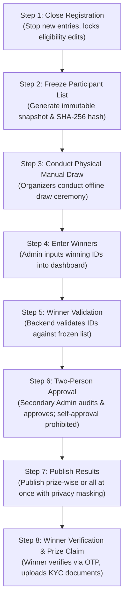

# Grand Lucky Draw — Management Platform

**Campaign Tagline:** *"Dream Big... Win Big..."*

A complete, production-ready, luxury-themed full-stack platform for the **Grand Lucky Draw 2027**. Features dynamic prize catalogues, concurrency-safe participant ID generation, direct registration and participant login, digital participation passes with QR codes, and a secure manual draw management module with cryptographic SHA-256 list freezing and two-person dual-administrator verification.

---

## 🏆 Campaign Grand Prizes (70 Total Listed Units)

Directly inspired by the official campaign promotional poster:

| Prize | Category | Quantity | Key Specifications |
|---|---|---:|---|
| **Toyota Fortuner 4x4** | Luxury SUV | **4** | 2.8L Diesel, Auto 4x4, Flagship Luxury Trim |
| **Mahindra Thar 4x4** | Adventure SUV | **5** | mStallion Turbo, Hard Top, 4x4 Shift-on-Fly |
| **Maruti Suzuki Swift** | Premium Hatchback | **20** | Dualjet VVT, Smartplay Pro, High Fuel Efficiency |
| **High-Speed Electric Scooters** | Eco Two-Wheeler | **40** | 120 km True Range, Fast Charging, Anti-Theft GPS |
| **Luxury Farmhouse** | Real Estate | **1** | 1-Acre Gated Private Grounds, Swimming Pool |

*All prizes, images, descriptions, and quantities are dynamic and manageable via the Admin Dashboard without touching source code.*

---

## 🛡️ Core Business & Integrity Guarantee

> **CRITICAL ARCHITECTURAL DIRECTIVE:**  
> **The platform NEVER automatically selects random winners.**  
> The actual lucky draw is conducted **100% manually and physically** by organizers outside the website (via ballot barrels, tokens, and independent verification observers). The platform acts as a secure, tamper-proof administrative ledger.

### Manual Draw Lifecycle (7 Steps)



---

## 🔑 Default Credentials & Test Access

### Admin Accounts (Configured for Dual-Admin Approval Testing)
| Role | Email | Password | Responsibilities |
|---|---|---|---|
| **Super Admin** | `admin@grandluckydraw.com` | `Password@123` | Full system control, draw close/freeze, unpublishing |
| **Draw Officer (Admin)** | `officer@grandluckydraw.com` | `Password@123` | Secondary auditor for two-person approvals |

### Participant Accounts & OTP
- **Universal Test OTP:** `123456` *(Valid across all registration and verification flows)*
- **Sample Pre-Seeded Participants:** 25 realistic participants across Indian cities (`LD2027-000001` through `LD2027-000025`).

---

## 🚀 Quick Start Guide

### 1. Requirements
- Node.js v18+ (tested on v22)
- npm v9+

### 2. Installation
```bash
# Install root dependencies
npm install

# Install server and client dependencies
cd server && npm install
cd ../client && npm install
cd ..
```

### 3. Database
The platform automatically connects to your MongoDB Atlas cluster if `MONGODB_URI` is provided in `server/.env`.  
If `MONGODB_URI` is left blank, an **in-memory replica set (`mongodb-memory-server`) automatically initializes and auto-seeds all 70 prizes, campaign settings, sample participants, and admin credentials**.

### 4. Running the Platform
```bash
# Build the client for production
npm run build

# Start the unified full-stack server (serves frontend + backend on port 5000)
npm start

# OR run in development mode (backend on 5000, Vite hot reload on 3000)
npm run dev
```

Visit the website at:  
- **Public Website & Participant Portal:** [http://localhost:5000](http://localhost:5000) (or `http://localhost:3000` in dev mode)  
- **Admin Panel:** [http://localhost:5000/admin/login](http://localhost:5000/admin/login)

---

## 📁 System Architecture & Routes

### Public Website
- `/` — Luxury Hero, Countdown Timer (19 May), Dynamic Target Progress Bar, 70 Prizes Showcase, How It Works, Announcements, FAQs, Contact.
- `/about` — Campaign background, vision, and manual draw methodology.
- `/prizes` — Filterable catalogue of all 70 prizes with details modal.
- `/how-it-works` — 6-step participation and verification guide.
- `/register` — 3-step registration with mobile OTP and instant digital lucky draw ticket generation.
- `/login` — Participant OTP Login & Admin Command Portal.
- `/draw-information` — Transparency disclosure, SHA-256 list freezing protocols.
- `/winners` — Official published results grouped by prize, participant ID search, celebratory confetti.
- `/verify-winner` — Winner verification via OTP, claim documentation submission, and live claim status tracking.
- `/faq`, `/contact`, `/terms-and-conditions`, `/privacy-policy`

### Participant Portal
- `/participant/dashboard` — Personal dashboard, unique participant ID badge, draw countdown, announcements.
- `/participant/profile` — Update permitted info (locked ID and eligibility).
- `/participant/participation` — Digital Participation Pass with QR code, print/download option.
- `/participant/announcements` — Bulletins from organizers.

### Admin Command Center
- `/admin/dashboard` — 8 key metric cards, live draw pipeline banner, regional breakdown chart.
- `/admin/participants` — View, search, filter, disqualify with mandatory reason, export Excel/CSV.
- `/admin/prizes` — Dynamic prize CRUD, image uploads, quantity adjustments.
- `/admin/campaigns` — Date management (1 Dec to 19 May), participant target (10,000), compliance toggles.
- `/admin/draw-management` — Step 1: Close registration; Step 2: Freeze list, generate SHA-256 hash, download official Excel/CSV, verify integrity.
- `/admin/enter-winners` — Step 4 & 5: Manual winner entry with real-time validation against frozen list and duplicate win prevention.
- `/admin/winner-approvals` — Step 6: Two-person approval queue with self-approval prevention.
- `/admin/winners` — Step 7: Prize-wise or universal winner publication, documented unpublishing.
- `/admin/prize-claims` — Step 8: Manage KYC claim statuses (Verified, Contacted, Documents Pending, Approved, Awarded).
- `/admin/announcements` — Publish public and participant announcements.
- `/admin/reports` — Analytics and exportable winners report.
- `/admin/audit-logs` — Immutable audit trail with actor, action, IP, and payload inspection.
- `/admin/settings` — Legal safety toggles, SMS simulation utility, database backup.

---

## 🔒 Security & Concurrency Guarantees

1. **Atomic Participant ID Generation:**  
   Uses MongoDB atomic `findOneAndUpdate` with `$inc` on the `Counter` model, eliminating race conditions during simultaneous registrations. Formats sequential IDs like `LD2027-000001`.
2. **Cryptographic SHA-256 Freeze:**  
   Canonical alphabetical sort over all verified eligible IDs hashed using SHA-256 (`crypto.createHash('sha256')`). Guarantees zero post-draw participant modification.
3. **Four-Eyes Dual Admin Approval:**  
   Enforced at the database controller level: `if (approval.enteredBy.toString() === req.user._id.toString()) return res.status(403)`. A single admin cannot approve their own entries.
4. **Data Protection & Masking:**  
   Public results mask winner identities (e.g. `Rahul S*****`, New Delhi). Mobile numbers and addresses are strictly concealed from public routes.
5. **Rate Limiting & Bot Protection:**  
   Express rate limiters protect registration, login, and OTP request endpoints.

---

## 📜 Legal & Launch Compliance

- **Grand Lucky Draw Branding:** Official campaign identity, disclaimers, and contact information are integrated across all customer-facing touchpoints.
- **Footer Attribution:** Developer attribution with hyperlink to `https://independentmedias.in` is housed in the global footer.
